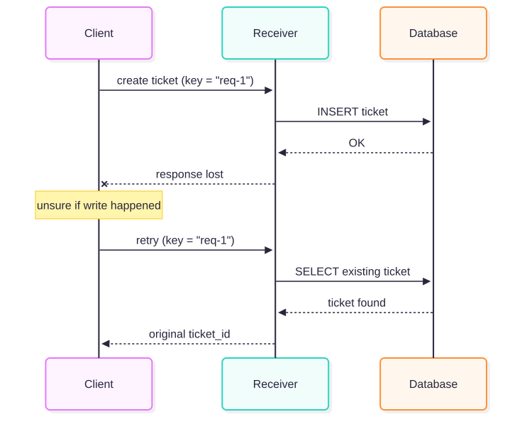

# Durable Command Receiver — P01

> **A reference implementation of receiver-side idempotency for durable command execution.**

Part of the [Open Source AI Engineering Playbook](https://github.com/manjunath-hanmantgad/opensource-playbook).

When a command crosses a process boundary, the acknowledgement can be lost while the write succeeds. Retries then risk duplicate outcomes. This repository provides a minimal, correct, and tested pattern for closing that gap at the receiver.

## The write/ack gap



Without receiver-side idempotency, the retry creates a second ticket. With it, the retry returns the exact same result.

## What this implementation proves

- **Same key, same payload** → returns the original ticket.
- **Concurrent retries** → only one ticket is created (database-enforced).
- **Same key, different payload** → rejected as a conflict.
- **Receiver restart** → stored results survive because persistence lives in SQLite.

## Quick start

Requires Python 3.12 and [uv](https://docs.astral.sh/uv/).

```sh
uv sync --frozen
uv run --frozen pytest -q
```

No Docker, no external services, no secrets. The full test suite runs in ~0.05 s.

## How it works


The receiver stores three things atomically:

1. the stable `command_key`,
2. a digest of the payload,
3. the business result (`ticket_id`).

The uniqueness of `command_key` is enforced by the database, not by application-level locking, so concurrent retries race safely.

## Architecture


| File | Responsibility |
| --- | --- |
| `src/p01/contracts.py` | `Command`, `Ticket`, and canonical SHA-256 digest. |
| `src/p01/receiver.py` | SQLite-backed receiver with atomic insert-or-return logic. |
| `tests/test_gap.py` | Proofs for retry, concurrency, conflict, restart, and digest stability. |

Diagram sources live in [`architecture/`](architecture/).

## Usage example

```python
from p01.contracts import Command
from p01.receiver import MockReceiver

receiver = MockReceiver("/tmp/tickets.db")
cmd = Command(key="req-1", payload={"title": "Fix login", "priority": "high"})

first = receiver.create_ticket(cmd)
second = receiver.create_ticket(cmd)

assert first.ticket_id == second.ticket_id
```

## Guarantees and scope

This is a **bounded, correct primitive**, not a full workflow engine.

| In scope | Out of scope (intentionally) |
| --- | --- |
| Receiver-side idempotency | HTTP API, auth, multi-tenancy |
| Atomic key-result storage | LangGraph, checkpoints, distributed workers |
| SQLite persistence | Real ticket vendors or external APIs |
| Deterministic canonical digests | Performance or scale benchmarks |

Use it as a starting point for durable command patterns. Add HTTP, auth, and orchestration only when your workload needs them.

## Test coverage

```text
uv run --frozen pytest -q
```

- `test_lost_ack_retry_returns_same_ticket`
- `test_concurrent_duplicates_create_one_ticket`
- `test_changed_payload_conflicts`
- `test_survives_receiver_restart`
- `test_command_digest_is_stable_and_payload_sensitive`

## Roadmap

P01 establishes the core receiver contract. Later work may extend this into a full approval-gated workflow with HTTP boundaries, durable checkpoints, and crash-recovery proofs — each layer tested independently before it is added.

## License

MIT — see [`LICENSE`](LICENSE).
