# Durable Command Receiver — P01

> **A reference implementation of receiver-side idempotency for durable command execution.**

When a command crosses a process boundary, the acknowledgement can be lost while the write succeeds. Retries then risk duplicate outcomes. This repository provides a minimal, correct, and tested pattern for closing that gap at the receiver.

## The write/ack gap


The failure mode is simple but expensive:

1. A client sends `create ticket` to an external API.
2. The API writes the ticket to its database.
3. The response is dropped, the server crashes, or the client times out before receiving the acknowledgement.
4. The client retries the same request.
5. Without receiver-side idempotency, the retry creates a second ticket.

The retry is rational. The client cannot distinguish "write failed" from "write succeeded but response lost." Only the receiver can answer that question, because only the receiver saw the commit.

## What this implementation proves

- **Same key, same payload** → returns the original ticket.
- **Concurrent retries** → only one ticket is created (database-enforced).
- **Same key, different payload** → rejected as a conflict.
- **Receiver restart** → stored results survive because persistence lives in SQLite.

## Why this matters: real-world use cases

Any system that issues consequential commands to an external service needs this property. Examples include:

| Domain | Command | Cost of duplicate |
| --- | --- | --- |
| Support platforms | Create ticket | Two agents work the same issue; customer confusion |
| Payments | Charge customer | Double charge; refunds; compliance risk |
| Inventory | Reserve item | Oversold stock; fulfillment failure |
| Subscriptions | Activate plan | Duplicate billing; support tickets |
| Logistics | Book shipment | Two trucks for one load; billing disputes |
| Healthcare | Schedule procedure | Double booking; patient safety risk |

In each case, the command is not safe to retry unless the receiver can recognize that it has already been executed.

## What problem this fixes

The root problem is **ambiguous outcome**. After a timeout or crash, the client has three possible states:

- The command never reached the receiver.
- The command reached the receiver but failed before writing.
- The command was written, but the acknowledgement never reached the client.

A client-side log, checkpoint, or "retry id" cannot distinguish the third case from the first two. The only authoritative record is at the receiver. By storing `(command_key, payload_digest, result)` atomically, the receiver converts an ambiguous retry into a deterministic replay.

## Where this pattern lives in a system

```text
┌─────────────┐      ┌─────────────────────┐      ┌─────────────────┐
│   Client    │ ──▶  │  Durable boundary   │ ──▶  │  External API   │
│  (worker,   │      │  (this receiver)    │      │  (ticket vendor, │
│   service)  │ ◀──  │                     │ ◀──  │   payment proc, │
└─────────────┘      └─────────────────────┘      │   inventory)    │
                                                   └─────────────────┘
```

This receiver sits at the boundary between your process and the external service. It is the last place where you can prevent duplicate external effects before they become visible to customers, finance, or operations.

## Quick start

Requires Python 3.12 and [uv](https://docs.astral.sh/uv/).

```sh
uv sync --frozen
uv run --frozen pytest -q
```

No Docker, no external services, no secrets. The full test suite runs in ~0.05 s.

## How it works


The receiver stores three things atomically:

1. the stable `command_key`,
2. a digest of the payload,
3. the business result (`ticket_id`).

The uniqueness of `command_key` is enforced by the database, not by application-level locking, so concurrent retries race safely.

### Key design decisions

- **Stable command key.** The caller must supply a key that identifies the intent across retries. A UUID generated by the caller at submission time is typical.
- **Payload digest.** The receiver hashes the canonical JSON of the payload. If the same key is reused with different data, the digests mismatch and the receiver rejects the call. This prevents a retry from silently overwriting a previous intent.
- **Database-enforced uniqueness.** A `UNIQUE(command_key)` constraint is the single source of truth for concurrency. Ten threads retrying simultaneously still produce one row.
- **Persistence survives restart.** SQLite is sufficient to prove the pattern. In production this would be PostgreSQL or the vendor's own idempotency store, but the contract is identical.

## Architecture



| File | Responsibility |
| --- | --- |
| `src/p01/contracts.py` | `Command`, `Ticket`, and canonical SHA-256 digest. |
| `src/p01/receiver.py` | SQLite-backed receiver with atomic insert-or-return logic. |
| `tests/test_gap.py` | Proofs for retry, concurrency, conflict, restart, and digest stability. |

Diagram sources live in [`architecture/`](architecture/).

## Usage example

```python
from p01.contracts import Command
from p01.receiver import MockReceiver

receiver = MockReceiver("/tmp/tickets.db")
cmd = Command(key="req-1", payload={"title": "Fix login", "priority": "high"})

first = receiver.create_ticket(cmd)
second = receiver.create_ticket(cmd)

assert first.ticket_id == second.ticket_id
```

## Failure modes handled

| Scenario | Behavior |
| --- | --- |
| Lost acknowledgement | Retry returns the original result. |
| Concurrent retries | Database constraint serializes; one ticket created. |
| Changed intent under same key | `ConflictError`; existing result is preserved. |
| Receiver restart before acknowledgement | New process reads the same SQLite file and returns the stored result. |
| Crash between commit and response | Next retry reads the committed row. |

## Guarantees and scope

This is a **bounded, correct primitive**, not a full workflow engine.

| In scope | Out of scope (intentionally) |
| --- | --- |
| Receiver-side idempotency | HTTP API, auth, multi-tenancy |
| Atomic key-result storage | LangGraph, checkpoints, distributed workers |
| SQLite persistence | Real ticket vendors or external APIs |
| Deterministic canonical digests | Performance or scale benchmarks |

Use it as a starting point for durable command patterns. Add HTTP, auth, and orchestration only when your workload needs them.

## Test coverage

```text
uv run --frozen pytest -q
```

- `test_lost_ack_retry_returns_same_ticket`
- `test_concurrent_duplicates_create_one_ticket`
- `test_changed_payload_conflicts`
- `test_survives_receiver_restart`
- `test_command_digest_is_stable_and_payload_sensitive`

## Roadmap

P01 establishes the core receiver contract. Later work may extend this into a full approval-gated workflow with HTTP boundaries, durable checkpoints, and crash-recovery proofs — each layer tested independently before it is added.

## License

MIT — see [`LICENSE`](LICENSE).
